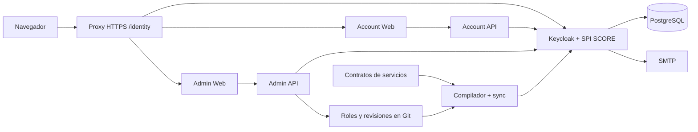

# Plan de implementación de SCORETech Identity

Fecha: 5 de noviembre de 2026.

Estado: documento de planificación original, conservado como referencia de las
decisiones. La tripleta y el laboratorio local están implementados en este
repositorio. Consulta [README](../README.md) y [operaciones](OPERATIONS.md) para
los comandos vigentes; la preparación de producción no equivale a un despliegue.

## 1. Objetivo y decisiones confirmadas

Crear el proveedor de identidad común del ecosistema SCORETech a partir del
Identity de Tentu, conservando su personalización y evitando reimplementar sus
flujos de identidad. La primera entrega debe demostrar la tripleta Identity,
Account y Admin funcionando conjuntamente.

| Decisión | Acuerdo |
| --- | --- |
| Tecnología | Keycloak con tema propio y extensiones reutilizadas de Tentu |
| Repositorio | `SCORETech-identity` |
| Marca | SCORE / SCORETech Identity |
| Realm | `score`, con nombre visible SCORE; convención técnica en minúsculas |
| URL inicial | `https://sphere.score.us.es/identity` |
| Cambio de dominio | Configuración central; sin URLs de producción incrustadas en código |
| Registro | Público, con correo verificado |
| Autenticación | Sin contraseña: OTP por correo, passkeys y TOTP, como en Tentu |
| Administración | Passkey obligatoria, también para operadores delegados |
| Acceso a servicios | Asignación por administrador; registrarse no concede acceso al resto del ecosistema |
| Catálogo de roles | Editable desde Admin para determinar los accesos a servicios de cada rol |
| Correo | Brevo, proveedor ya utilizado en SPHERE |
| Idioma del producto | Siempre inglés: login, Account, Admin y emails |
| Primera integración | Account y Admin contra el mismo Identity Provider |
| SPHERE y SPACE | Migración de usuarios e integración posteriores a la primera entrega |
| Recorte de Admin | Administración de identidad y usuarios; retirar negocio de Tentu |
| Recorte de Account | Configuración personal, seguridad y sesiones; retirar oposiciones y pagos |

El modelo passwordless, la edición del catálogo desde Admin, Brevo y el inglés
como único idioma quedan confirmados. La configuración técnica de clientes y
permisos atómicos se mantiene versionada por servicio; el administrador edita los
roles que agrupan esos permisos y asigna los roles a usuarios. Faltan detalles
operativos de la máquina, remitente/credenciales SMTP y publicación del catálogo,
recogidos en la sección 13; no son decisiones de alcance pendientes.

## 2. Viabilidad y ahorro real

La solución es viable y encaja con la necesidad de compartir identidad entre
varios servicios. Keycloak ya proporciona los protocolos de identidad y sesión;
Tentu añade el login personalizado, la administración y el autoservicio buscados.
OIDC será el protocolo de inicio de sesión, construido sobre OAuth 2.0; los
clientes descubrirán sus endpoints mediante el documento de discovery del realm.
Véase la [documentación OIDC de Keycloak](https://www.keycloak.org/securing-apps/oidc-layers).

La mayor reutilización está en el provider Java, los adaptadores internos, los
flujos de seguridad y sus pruebas. El trabajo significativo será separar negocio,
eliminar acoplamiento con dominios/infraestructura de Tentu, adaptar todas las
rutas al prefijo y reconstruir la identidad visual. No se debe estimar como una
copia del tema con un cambio de realm.

El código observado usa Keycloak **26.7.1**, un provider propio **0.12.8 en
desarrollo**, React 19, Vite, Tailwind 4, Express 5, TypeScript, Node 22 y pnpm.
Estas son referencias de extracción, no una certificación de versiones aptas para
producción. Seleccionar una versión mantenida y parcheada al implementar, validando
primero la compatibilidad del SPI y de config-cli; no actualizar simultáneamente
toda la pila por costumbre. La documentación oficial `latest` consultada ya
corresponde a una versión posterior a la del origen local.

El [inventario](INVENTARIO_TENTU.md) registra rutas y revisiones. Hay cambios
locales en los repositorios de origen: hay que seleccionar y congelar una base
reproducible antes de copiarla. El plan no considera esos cambios publicados ni
verificados en producción.

## 3. Alcance funcional de la primera entrega

### 3.1 Identity Provider

- Registro e inicio de sesión centralizados, verificación de correo y cierre de
  sesión, conservando el flujo passwordless de Tentu con OTP por correo.
- Passkeys y TOTP mediante las acciones nativas/extensiones existentes.
  Credenciales enviadas directamente a Keycloak. Toda administración requiere
  passkey y no puede degradarse a OTP por correo o TOTP como alternativa de operador.
- Cambios de correo con verificación, reverificación de acciones sensibles,
  invitaciones y recuperación asistida.
- Realm nuevo y vacío `score`: sin usuarios, contraseñas, claves de firma,
  secretos, clientes de negocio ni asignaciones de Tentu.
- Tema de login y email `score`, con pantallas de error, caducidad, permisos
  denegados, alta, invitación y recuperación coherentes con SCORE, siempre en inglés.
- Registro mínimo: correo verificado, nombre y apellidos. Teléfono opcional en
  perfil. Retirar DNI/NIF/NIE, domicilio fiscal y consentimiento comercial de
  Tentu. Referencias a privacidad/términos de SCORE configurables, con evidencia
  de la versión aceptada cuando exista una aceptación expresa.
- Política de registro sin rol de acceso a servicios por defecto. Las invitaciones
  solo podrán asignar los roles revisados para esa invitación.

### 3.2 Account

Conservar información personal, avatar predefinido, cambio de correo, apariencia,
métodos de acceso, dispositivos/sesiones, actividad de identidad y cierre de
sesiones propias. El usuario accede a su cuenta aunque todavía no tenga permiso
para ninguna aplicación del ecosistema.

Conservar el contrato de foto de perfil si se configura almacenamiento privado
compatible con S3. Sin almacenamiento configurado, ofrecer los avatares locales y
no mostrar un botón de subida que vaya a fallar. No introducir almacenamiento
público ni un nuevo servicio S3 solo para completar el núcleo inicial.

Retirar `OppositionsPanel`, `CommercePanel`, compras, enlaces a ranking/portal,
documentos fiscales, preferencias de marketing y los avisos/campañas dependientes
de Legal API. Un enlace estático a privacidad/términos no requiere ese subsistema.
El cierre/purgado automático de una cuenta no se debe presentar como disponible:
no está resuelto por los flujos de campaña de Tentu y queda fuera de esta entrega.

### 3.3 Admin

Conservar directorio, búsqueda, paginación, ficha de usuario, alta/invitación,
edición de campos permitidos, activación/desactivación, asignación de roles y
permisos mediante el catálogo autorizado, revocación de sesiones, métodos de
seguridad, recuperación asistida y eventos de identidad. Las acciones destructivas
deben conservar sus controles y confirmaciones del flujo original.

El operador no puede conceder privilegios fuera de su capacidad de delegación,
quitarse la última vía de administración ni modificar roles técnicos de máquina.
Definir y probar expresamente estas reglas; no inferirlas de la visibilidad de
botones. La edición de roles de un usuario y la definición de un rol global son
operaciones distintas, con permisos separados.

Admin incluirá el editor del catálogo de roles: crear y modificar roles ordinarios,
seleccionar los accesos a servicios y permisos que agrupan, consultar su impacto
y retirarlos de forma controlada. También permite asignar esos roles a usuarios.
Conservar el historial de revisiones, motivo, actor y restauración de definiciones;
mostrar por separado cambios guardados y cambios aplicados. El alta técnica de un
cliente OAuth y la declaración de permisos atómicos siguen en el contrato de su
servicio, sin exponer secretos ni permitir inventar permisos desde la web.

Retirar oposiciones, matrículas, convocatorias, exámenes, rankings, compras,
llamadas, comunicaciones masivas, campañas legales, pasarelas a esos dominios,
webhooks WooCommerce y selectores de promoción entre entornos. El recorte incluye
sus endpoints, permisos, audiencias, variables, clientes y dependencias.

### 3.4 Fuera de la primera entrega

Migración o federación de usuarios de SPHERE/SPACE, cambios de sus permisos de
negocio, integración con CAS/Google/LDAP, SAML específico, multiempresa,
aprovisionamiento SCIM, clientes OAuth públicos creados por terceros, pagos y
campañas legales. Keycloak puede permitir futuras ampliaciones, pero no son
dependencias de la tripleta inicial.

## 4. Arquitectura propuesta

Un monorepositorio con responsabilidades separadas permite construir y arrancar
todo sin exigir clones hermanos, el registry privado de Tentu, AWS, Kubernetes
ni Argo CD. El laboratorio usa fixtures para la integración de catálogo; la edición
versionada de producción reutilizará el adaptador GitHub de Tentu y requerirá una
GitHub App de SCORE con acceso al repositorio del catálogo.

```text
SCORETech-identity/
  provider/                    # distribución Keycloak + SPI Java + temas score
  config/                      # realm base, entornos, catálogo y snapshots
  apps/
    account-web/               # React, cliente OIDC público
    account-api/               # autoservicio limitado al sub autenticado
    admin-web/                 # React, cliente OIDC público
    admin-api/                 # usuarios, catálogo y revisiones autorizadas
  packages/
    identity-internal/         # adaptadores y autenticador compartidos de servidor
    ui/                        # controles reutilizados por ambas webs y marca SCORE
  tooling/                     # compilación/validación y aplicación declarativa
  deploy/
    local/                     # Compose, correo capturado y datos ficticios
    production/                # Compose y plantilla de integración con el proxy
  tests/e2e/                   # tripleta real detrás del prefijo
  docs/
```

Es la estructura objetivo, todavía no creada. Los componentes React de uso
compartido vivirán en `packages/ui`; el paquete de identidad interna no debe
contener UI ni lógica comercial. Usar pnpm workspace y lockfile coherente.



Las llamadas de navegador a las APIs también pasan por el proxy. Las flechas
entre APIs y Keycloak representan transporte interno con credenciales de máquina
y, donde la operación lo exige, la identidad verificada del actor.

| Componente | Estado que posee | Comunicación |
| --- | --- | --- |
| Keycloak + SPI | Identidades, credenciales, sesiones, invitaciones/recuperación y registro de autorización | OIDC público; recursos de proveedor y Admin REST internos según función |
| PostgreSQL dedicado | Datos de Keycloak y tablas JPA de sus extensiones | Accesible por el provider; copias por proceso de operaciones |
| Account Web | Estado de interfaz y transacción OIDC | Account API y flujos de Keycloak |
| Account API | Sin base de usuarios propia | Credencial `identity-account-service` y adaptador restringido |
| Admin Web | Estado de interfaz y transacción OIDC | Admin API; Account API para preferencias propias si se conserva ese uso |
| Admin API | Auditoría; edición de roles versionados y lectura de catálogo aplicado | Credencial `identity-admin-service`, proveedor y GitHub App independiente |
| Compilador + sync | Fuente versionada y revisión deseada/observada | Configuración de realm y registro transaccional con credencial independiente |
| Servidor estático/gateway | Sin identidades | Distribuye las dos webs y enruta sus APIs |

Las dos APIs siguen separadas: Account deriva su objetivo del `sub` verificado y
no recibe un identificador de usuario arbitrario; Admin comprueba el permiso de
cada operación. Sus credenciales de servicio no llegan al navegador. No habrá
una copia paralela del directorio en MongoDB ni un JWT propio de SCORE emitido
por una de estas APIs.

Los permisos Keycloak `manage-users` de una cuenta de servicio pueden abarcar el
realm: no implican aislamiento nativo por sujeto. Mantener el adaptador Account
restringido y las comprobaciones del SPI/API, revisar los roles de cada cliente
de máquina y probar que no se puede usar el autoservicio para administrar cuentas.

## 5. SSO, aplicaciones y permisos

### 5.1 Contrato de integración

1. Cada aplicación declara cliente OIDC, callbacks, orígenes, logout, audiencias y
   permisos propios en un manifiesto versionado. Adaptar el compilador de Tentu.
2. Una SPA usa Authorization Code con PKCE S256 y no recibe secretos. Deshabilitar
   flujos implícito y de contraseña directa para estos clientes.
3. La sesión del realm permite visitar otro cliente sin repetir autenticación,
   salvo que la operación o política de seguridad exija reverificación.
4. La API destinataria valida firma con JWKS, algoritmo admitido, `iss`, `aud`,
   expiración, `sub` y cliente autorizado cuando proceda. Valida permisos y
   propiedad del recurso en servidor.
5. Una cuenta nueva solo puede configurar su perfil. Acceder a otra aplicación
   requiere asignación administrativa. Autenticación y autorización tienen
   resultados distintos: 401 para identidad inválida y 403 para falta de permiso.

Crear un cliente OAuth no crea por sí solo los permisos del servicio ni los
concede a los usuarios. La ruta sencilla de alta será: declarar contrato, validar
y aplicar snapshot, configurar issuer/clientId en la aplicación y asignar el rol
correspondiente desde Admin. La aplicación conserva sus reglas de recurso/tenant.

### 5.2 Clientes iniciales

| Cliente / recurso | Tipo y cometido |
| --- | --- |
| `identity-account-web` | Público PKCE; audiencia Account API |
| `identity-admin-web` | Público PKCE; audiencia Admin API y Account API solo si la UI la usa |
| `identity-account-api` | Audiencia del autoservicio, sin login de navegador |
| `identity-admin-api` | Audiencia administrativa, sin login de navegador |
| `identity-account-service` | Confidencial; funciones de autoservicio mediante adaptador restringido |
| `identity-admin-service` | Confidencial; operaciones administrativas necesarias |
| `identity-config-sync` | Confidencial; sincronización declarativa, no credencial de una web |

Mantener los identificadores neutrales reutilizables evita renombrados sin valor.
Eliminar todas las audiencias a oposiciones, portal, legal y llamadas. Configurar
`tokenPermissions: {source: policies}` o su equivalente SCORE para emitir la
intersección entre permisos del usuario y permisos requeridos por cada cliente.
No activar `fullScopeAllowed` para resolver un fallo de permisos. Conservar el
scope/mapeador que aporta `sub` al reemplazar los scopes predeterminados.

### 5.3 Catálogo y asignaciones

Reutilizar permisos atómicos `identity:users:*`, `identity:invitations:*` y los de
lectura de roles/grupos necesarios, además de `identity:roles:manage` para el
editor global. Retirar permisos de contraseñas legacy y los de funciones excluidas.
Cada endpoint retenido
debe tener política, y cada permiso del catálogo debe tener un consumidor real.

La entrada administrativa usa únicamente
`admin-web:<entorno>:access`, con permisos de operación separados. El rol compuesto
administrativo es una comodidad de asignación, nunca un segundo requisito de
entrada. Las cuentas de soporte delegadas deben funcionar sin un rol global
`administrador` cuando tienen los permisos precisos.

**Adaptación necesaria:** el código de origen identifica varias protecciones de
passkey por pertenencia a `administrador`. Extender la clasificación de seguridad
a todo acceso administrativo
delegado, conservando el permiso de entrada y la autorización atómica. Probarlo
en login, SSO existente, emisión, refresh, operaciones sensibles y recuperación.
No resolverlo exigiendo el rol compuesto a todos los operadores.

Propuesta de roles iniciales: miembro sin accesos extra, soporte con operaciones
limitadas y administrador de identidad. Definir una matriz exacta antes de
sembrarlos, incluyendo quién puede asignar roles privilegiados. El operador de
infraestructura del realm `master` no es un usuario de Admin Web.

Los entornos se declaran explícitamente. Adaptar validadores y compilador para
`local`, `staging` y `production`, sin deducir entorno por el hostname. Una misma
instancia administrativa gestiona su entorno; no necesita cambiar producción y
staging desde un selector de la UI.

### 5.4 Fuente de verdad y aplicación

Manifiestos por propietario + roles/grupos globales componen un snapshot inmutable
con revisión/digest. El mismo snapshot alimenta config-sync y las APIs que muestran
roles/permisos. Reutilizar el registro transaccional del SPI para aplicar permisos,
composites y restricciones de token conjuntamente; no fragmentar esa aplicación
en escrituras independientes.

La definición de roles tiene dos entradas coordinadas: los permisos y clientes
proceden de contratos versionados de servicios; la agrupación en roles procede del
editor de Admin. Ambas se componen en el mismo snapshot. La sección siguiente
define la publicación para que un sync no sobrescriba lo editado desde la web.

Separar bootstrap de reconciliación: bootstrap crea el realm y la credencial de
sync una sola vez; reconciliación aplica configuración sin borrar usuarios,
sesiones ni credenciales. Ejecutarla dos veces debe ser inocuo. No usar un import
de arranque como mecanismo de actualización de un realm existente.

Extraer el núcleo del compilador Ruby y config-sync; sustituir los wrappers que
suponen repos GitOps, charts e instalaciones GitHub de Tentu por el repositorio de
SCORE y un job puntual de Compose. Conservar las validaciones de propiedad,
duplicados, referencias, generación y restricciones por cliente. El login y las
decisiones de autorización no deben consultar GitHub por petición. Un fallo de Git
puede impedir editar/publicar, pero no debe detener el login ni invalidar el último
catálogo cuya aplicación se haya confirmado.

### 5.5 Editor de roles y publicación desde Admin

Reutilizar `CataloguePanel`, comparación/historial y el módulo de catálogo de
Admin API, incluidos su adaptador GitHub, concurrencia optimista y auditoría.
Eliminar el selector de varios entornos: la consola opera sobre su entorno
configurado. La versión inicial permite editar roles ordinarios y sus permisos
existentes; no necesita incorporar un editor global de grupos para cumplir el
objetivo. El rol administrativo protegido sigue derivándose del catálogo y no
puede editarse para eludir sus restricciones.

El editor mostrará permisos agrupados por servicio, diferenciando entrada y
operaciones. Por ejemplo, un rol `Researcher` podrá incluir los accesos declarados
por los servicios que se integren en el futuro. La primera entrega solo muestra
los servicios realmente registrados de la tripleta; no concede ni simula accesos
a SPHERE/SPACE antes de integrarlos. Los nombres y descripciones iniciales se
presentan en inglés.

Flujo completo de una edición:

1. Cargar la definición deseada, su revisión base y la revisión aplicada. Exigir
   `identity:roles:view` para consultar y `identity:roles:manage` para modificar,
   además del acceso a Admin y passkey. Revalidar permisos vigentes al escribir.
2. Editar nombre, descripción y conjunto de permisos del rol; previsualizar la
   diferencia y las asignaciones afectadas. Mantener un identificador estable
   independiente del nombre visible. Un operador no puede crear un rol que
   reúna privilegios que no está autorizado a delegar.
3. Validar en servidor: permisos existentes del entorno, propietario del contrato,
   ausencia de roles técnicos/de máquina o protegidos, y conservación de una vía
   administrativa. La retirada de un rol debe mostrar su impacto en usuarios.
4. Guardar motivo y actor con control de revisión base. Reutilizar el commit
   atómico de Tentu para definición, snapshot y revisión deseada. Una edición
   concurrente obsoleta devuelve 409; no sobrescribe cambios ajenos.
5. La publicación desencadena el job de sincronización del host mediante el flujo
   de despliegue de SCORE. Aplicar una revisión exacta, con ejecución serializada
   por entorno; no ejecutar comandos de Docker desde Admin API ni darle acceso al
   socket del host o la credencial de config-sync.
6. Config-sync valida contratos, compone el snapshot y reconcilia el registro del
   provider. Actualiza las referencias de Account/Admin a ese mismo snapshot y
   verifica la revisión observada. No declarar aplicada una revisión solo porque
   el commit o el job hayan arrancado.
7. La UI distingue `Pending`, `Applying`, `Applied` y `Failed`. Durante aplicación
   o fallo, las asignaciones usan el catálogo activo confirmado; no el HEAD deseado
   de Git. Un fallo conserva el último activo, su diagnóstico y el reintento de
   esa revisión. Serializar también publicación y recuperación de fallos.
8. Restaurar una definición histórica crea una revisión/generación nueva contra
   los contratos actuales. Conservar sujetos y asignaciones; reutilizar la
   retirada de roles con composites vacíos del registro para evitar purgas y
   permitir recuperación, con política explícita sobre su eventual reasignación.

Propuesta operativa: usar una rama de datos del repositorio SCORETech-identity
para el catálogo por entorno y snapshots; los contratos proceden de una revisión
de código seleccionada. La GitHub App recibe `Contents: write` solo sobre este
repositorio. El adaptador limita rutas y rama a datos del catálogo y no permite
editar workflows/código; no se debe presentar esa restricción de código como un
permiso por ruta que GitHub conceda a la App. El aplicador y su configuración se
mantienen en el flujo de despliegue controlado, no en archivos ejecutables que el
editor pueda cambiar.

Adaptar los endpoints ya existentes `GET /catalogue`, `POST /catalogue/validate`,
`POST /catalogue/revisions`, `GET /catalogue/revisions` y
`POST /catalogue/rollbacks`, y la consulta de estado de aplicación. Documentar el
contrato propio en OpenAPI antes de implementar cambios. Las asignaciones a
usuarios conservan su permiso distinto `identity:users:update:roles`.

Las pruebas locales sustituyen la dependencia GitHub por su fixture de protocolo,
pero ejercitan el compilador y el provider reales al aplicar; esa fixture nunca
forma parte de las imágenes de producción. No añadir un segundo backend de
catálogo de producción para poder desarrollar sin secretos.

## 6. Despliegue bajo `/identity`

### 6.1 Rutas públicas

Propuesta para el origen inicial `https://sphere.score.us.es`:

| Ruta | Destino |
| --- | --- |
| `/identity` | Redirección a `/identity/account/` |
| `/identity/account/` | Account Web |
| `/identity/account/auth/callback` | Callback OIDC de Account |
| `/identity/account/auth/verification-callback` | Callback de reverificación, si lo usa el flujo retenido |
| `/identity/account/invite` | Canje de invitación |
| `/identity/admin/` | Admin Web |
| `/identity/admin/auth/callback` | Callback OIDC de Admin |
| `/identity/admin/auth/verification-callback` | Callback de reverificación de Admin |
| `/identity/api/account/v1/account/…` | Account API, ruta interna `/v1/account/…` |
| `/identity/api/admin/v1/…` | Admin API, ruta interna `/v1/…` |
| `/identity/auth/realms/score/…` | Protocolos y recursos personalizados del realm |
| `/identity/auth/resources/…` | Recursos estáticos del tema Keycloak |

Issuer canónico:
`https://sphere.score.us.es/identity/auth/realms/score`.

Discovery:
`https://sphere.score.us.es/identity/auth/realms/score/.well-known/openid-configuration`.

Reservar `/identity/auth` completo para Keycloak evita la colisión de su Admin
REST `/admin/realms/…` con la web propia `/identity/admin/`. Su consola nativa y
Admin REST seguirán disponibles solo por red interna o acceso de operaciones;
Admin Web usa la API propia. No publicar a ciegas todo el prefijo del provider:
permitir los endpoints de realm y recursos realmente requeridos por el navegador,
y mantener internos `master`, Admin REST, métricas y recursos exclusivos de máquina.

Keycloak admite exposición bajo un prefijo mediante hostname/context path. Hay
que escoger una estrategia coherente de proxy y no sumar el prefijo dos veces.
La propuesta es que el provider escuche con `/identity/auth` y que el proxy
preserve ese path. Véase [reverse proxy de Keycloak](https://www.keycloak.org/server/reverseproxy).

En **26.7.1**, `http-relative-path` es una opción de construcción. Pasarla solo al
arrancar con `--optimized` no configura correctamente una imagen ya construida
para `/`. Incluir el prefijo en la construcción parametrizada de la imagen y
probarla en modo producción. Cambiar solo el dominio no exige reconstruir por
este motivo. Referencia: [HttpOptions de la versión de origen](https://github.com/keycloak/keycloak/blob/26.7.1/quarkus/config-api/src/main/java/org/keycloak/config/HttpOptions.java).

### 6.2 Configuración central y portabilidad

Contrato de configuración propuesto, todavía sin implementar:

```dotenv
IDENTITY_PUBLIC_ORIGIN=https://sphere.score.us.es
IDENTITY_BASE_PATH=/identity
IDENTITY_REALM=score
IDENTITY_ENVIRONMENT=production
IDENTITY_WEBAUTHN_RP_ID=sphere.score.us.es
```

Generar desde él issuer, URLs de las dos webs/APIs, callbacks, logout, orígenes
y configuración pública de navegador. Las credenciales permanecen en secretos
independientes. Una URL interna de transporte no cambia el `iss` público que las
APIs deben verificar. El hostname debe ser explícito, según la
[guía oficial de hostname](https://www.keycloak.org/server/hostname).

Adaptaciones concretas del origen:

- `auth.ts`: callbacks y logout construidos con el base path de cada web.
- `App.tsx`: comparaciones de `pathname`, invitaciones, ventanas de verificación
  y navegación considerando el prefijo.
- `config.ts`: retirar inferencias por `staging-*` y fallback a dominios de Tentu.
- Vite, HTML y servidor estático: base de assets, runtime config, enlaces,
  favicons y fallback de SPA limitado a la web correspondiente.
- Tema/Java/emails: enlaces absolutos derivados de la URL configurada, incluidos
  callbacks de invitación y recuperación. Retirar la suposición de un único
  callback en la raíz o del primer callback ordenado.
- Proxy: rutas más específicas antes del fallback de SPHERE, reescritura de APIs
  bien definida, sin HTML de SPA ante un endpoint OIDC o API inexistente.

El proxy existente de SPHERE declara `sphere.score.us.es`, Compose y Nginx. Es
evidencia de encaje con este esquema, no de que la máquina real tenga recursos
libres o coincida exactamente con ese fichero. La implementación preparará el
fragmento de integración en este repositorio; activarlo se hará en el despliegue
del proxy que corresponda, después de comprobar su configuración efectiva.

### 6.3 Proceso y recursos

Propuesta inicial: stack Compose independiente, PostgreSQL con volumen propio,
provider, dos APIs y un servidor de las dos webs; el proxy existente conserva
TLS y enruta `/identity`. Config-sync será una tarea puntual. En desarrollo se
añade Mailpit; en producción Keycloak usa el SMTP de Brevo, como detalla la sección
6.6. El editor de catálogo publica en Git y el flujo de despliegue invoca config-sync
como job puntual; no requiere Argo CD. No se requiere Redis para
esta extracción salvo que una necesidad concreta de límites distribuidos lo
justifique. Las APIs de origen usan limitadores locales por proceso.

Presupuesto orientativo para comprobar la máquina, no mínimo oficial ni medida:
reservar aproximadamente 3–4 GiB de RAM adicional para el conjunto y margen de
CPU de unas 2 vCPU para un uso inicial pequeño. El chart original permite hasta
2 GiB al provider por sí solo. Medir carga, memoria, correo y tiempos de login
antes de fijar límites. Compilar imágenes en CI para no competir con SPHERE.

PostgreSQL separado de MongoDB de SPHERE, con base/usuario/volumen propios. No
reutilizar usuarios de base de datos de otro producto. Una sola máquina es un
punto de fallo común: el objetivo inicial es recuperación comprobada, no alta
disponibilidad. No añadir Kubernetes para este despliegue si no existe ya.

### 6.4 Cambio futuro de dominio

Configurar un nuevo dominio será sencillo en código, pero no equivale a que las
sesiones y credenciales de navegador se trasladen automáticamente:

1. Preparar DNS/TLS y nueva configuración pública. Generar y revisar callbacks,
   logout, orígenes, enlaces de email, issuer y políticas de proxy.
2. Cambiar el hostname conservando el realm y la base de datos: no recrear usuarios
   ni cambiar sus `sub`. Los consumidores actualizan su issuer de forma coordinada.
3. Definir ventana de mantenimiento/transición y reautenticación. No aceptar
   cualquier issuer ni convertir un redirect HTTP en una compatibilidad OIDC.
4. Verificar RP ID y orígenes de WebAuthn antes del cambio. Una passkey registrada
   para el host original no tiene portabilidad automática a otro host/RP ID.
   Preferir conservar un dominio estable de autenticación; si se requiere moverlo,
   planificar registro de credenciales y recuperación antes de retirar el anterior.
5. Probar login, enlaces pendientes, refresh, logout y retorno desde ambas webs.

El RP ID define el ámbito de las credenciales; Keycloak usa por defecto el host
de su URL base cuando no se fija. Véase la
[política WebAuthn de Keycloak](https://www.keycloak.org/docs/latest/server_admin/index.html#_webauthn).
No ampliar el RP ID a todo `score.us.es` sin decidir qué subdominios se confían.

### 6.5 Seguridad del mismo origen y operación

Las rutas de un dominio no aíslan `localStorage` ni el código JavaScript de sus
aplicaciones por seguridad. El Admin original persiste tokens en `localStorage`;
adaptarlo a almacenamiento de sesión/memoria, claves por issuer/cliente y limpieza
al salir reduce persistencia, pero no crea aislamiento entre rutas. Desplegar la
tripleta bajo el host de SPHERE presupone confiar en todas las aplicaciones de ese
origen. Si se necesita esa separación, usar un origen dedicado para identidad/admin
antes de exponerlo; documentarlo como decisión de despliegue, sin añadir un BFF
especulativo a la extracción.

El proxy debe sobrescribir cabeceras forwarded confiables, impedir acceso externo
directo al provider, separar límites de login/OTP de llamadas normales y conservar
CSP, protecciones de iframe y validación exacta de origen en step-up. Probar los
iframes/popups retenidos; no desactivar CSP globalmente para hacerlos funcionar.
Los logs del proxy no deben almacenar códigos OIDC, OTP, enlaces de recuperación
ni tokens presentes en consultas; conservar auditoría por actor, operación,
destino, resultado y request ID sin secretos.

### 6.6 Brevo y referencia de SPHERE

La integración inspeccionada está en
`SPHERE/api/src/main/services/email/BrevoEmailService.ts`: usa `@getbrevo/brevo`,
`BREVO_API_KEY`, `BREVO_SENDER_EMAIL` y `BREVO_SENDER_NAME`. Envía verificación,
recuperación de contraseña y notificaciones por la API transaccional, con contenido
HTML/texto en inglés. Se registra en el contenedor de servicios y tiene pruebas
con el SDK sustituido. No se inspeccionaron credenciales ni se envió correo.

Para SCORETech Identity se reutiliza Brevo como proveedor y la configuración de
remitente, manteniendo Keycloak como emisor de sus propios flujos/plantillas. Se
propone SMTP nativo de Keycloak para conservar el provider de Tentu sin crear un
puente Node o un nuevo EmailSender SPI que replique el SDK de SPHERE. No copiar
las plantillas SPHERE de contraseña ni sus tiempos de expiración al flujo OTP.

| Dato | Configuración propuesta |
| --- | --- |
| Host | `smtp-relay.brevo.com` |
| Transporte | Puerto 465 con TLS implícito, sujeto a conectividad del host |
| Usuario y clave | Login SMTP y clave SMTP dedicada a Identity, inyectados como secretos |
| Remitente | Dirección transaccional autenticada de SCORE, por concretar |
| Nombre visible | `SCORETech Identity` |
| Contenido | Tema email `score`, inglés y versiones HTML/texto |
| Desarrollo/E2E | Mailpit, sin enviar a Brevo |

Brevo distingue claves SMTP y API: la `BREVO_API_KEY` de SPHERE no es la contraseña
del relay. Confirmar remitente/dominio y credencial SMTP antes de activar envío;
no copiar claves reales a configuración o snapshots versionados. Referencias:
[configuración SMTP de Brevo](https://help.brevo.com/hc/en-us/articles/7924908994450-Send-transactional-emails-using-Brevo-SMTP)
y [puertos y credenciales](https://developers.brevo.com/docs/smtp-integration).

Conservar límites y caducidad de OTP/invitación/recuperación del provider, manejar
errores de entrega sin emitir un éxito ficticio y no registrar códigos o enlaces
secretos. El comportamiento de desarrollo de SPHERE que imprime enlaces por
consola no se traslada a Identity: se inspeccionan en Mailpit. Verificar que los
enlaces de acción llegan intactos y no son reescritos por tracking; el origen
Tentu ya exige deshabilitarlo para esos mensajes. Comprobar esta configuración
para Identity sin cambiar el comportamiento de otros correos de SPHERE.

## 7. Diseño SCORE

Referencia inspeccionada visualmente y por estilos el 5/11/2026:
[score.us.es](https://score.us.es/). La marca combina rojo institucional, blanco,
grafito y logotipo geométrico; la tipografía de texto observada es Source Sans Pro
y los títulos usan Bunken Tech Sans Pro.

| Token de referencia | Valor observado | Uso propuesto |
| --- | --- | --- |
| Primario SCORE | `#BE1D37` | Acción principal, enlaces y acentos |
| Texto | `#212529` | Texto sobre superficies claras |
| Blanco | `#FFFFFF` | Superficies y contraste del encabezado |
| Verde de área | `#4CB493` | Acento secundario puntual |
| Granate de área | `#59162D` | Acento secundario puntual |
| Naranja de área | `#EF6F46` | Acento secundario puntual |
| Amarillo de área | `#F4AC2D` | Acento secundario puntual |

Los cuatro colores de áreas son referencias de marca, no colores obligatorios de
estados ni de texto pequeño. Definir tokens semánticos light/dark y comprobar
contraste, foco y errores antes de utilizarlos en controles.

Reutilizar el logo vectorial institucional desde un asset local autorizado;
referencia observada: `wp-content/themes/bootscore-child-main/img/logo/logo.svg`.
Confirmar disponibilidad/licencia de Bunken antes de distribuirla. Reservarla para
marca/títulos si procede; usar Source Sans Pro local para formularios y tablas,
sin depender de fuentes externas en una pantalla de autenticación.

Login: logo SCORE, nombre del servicio y contexto de la aplicación solicitante,
formulario compacto, un objetivo principal por pantalla y estados claros de OTP,
passkey y caducidad. Mantener el formulario server-rendered de Keycloak; no crear
una SPA que recoja credenciales. La personalización de temas y extensiones sigue
el mecanismo descrito en el
[Server Developer Guide](https://www.keycloak.org/docs/latest/server_development/#_themes).

Account: perfil, apariencia, seguridad y sesiones con navegación sencilla. Admin:
directorio como entrada, ficha, permisos asignados y actividad con acciones
consistentes. Eliminar tipografía, fondos, mascotas, avatares de academia, textos,
logos, dominios y verde neón de Tentu. No copiar el carrusel ni la densidad de la
web institucional a los formularios.

Probar teclado, etiquetas, lectores de pantalla, errores, foco tras diálogos,
autofill de OTP, tamaños móviles, zoom y movimiento reducido. Los controles
clicables de las webs tendrán `cursor-pointer`, estados disabled claros y foco
visible. En el tema FreeMarker usar el equivalente CSS de interacción.

### 7.1 Inglés como único idioma

Login, registro, OTP, passkeys, TOTP, invitación, recuperación, Account, Admin y
emails se entregan siempre en inglés. Incluir asuntos, textos HTML/plano, etiquetas
accesibles, validaciones, confirmaciones y errores visibles de las APIs. Ejemplos
de navegación: `Users`, `Invitations`, `Roles and permissions`, `Security events`,
`Profile`, `Security` y `Devices and sessions`.

Configurar realm/tema con locale `en`, limitar los idiomas admitidos a inglés y
retirar el selector de idioma. Adaptar mensajes españoles heredados en Java,
TypeScript, FreeMarker y traducciones de controles; no limitar el cambio al tema.
El navegador o un parámetro `ui_locales=es` no debe reintroducir textos en español.
Probar también usuarios con preferencia de idioma heredada o navegador español.
Los nombres introducidos por usuarios no se traducen. Este plan permanece en
español para facilitar la revisión con el responsable del proyecto.

## 8. Estrategia de reutilización

Extraer una copia mantenible en SCORE con procedencia registrada; evitar una
dependencia operativa de instalaciones Tentu. Conservar los avisos de licencia
MIT de los repositorios de origen en las partes reutilizadas. Los paquetes SDK
sin licencia visible necesitan aclarar su procedencia antes de redistribuirlos;
se puede reutilizar el cliente OIDC estándar ya presente y extraer solo las piezas
necesarias con derechos claros.

Secuencia de extracción:

1. Congelar revisión y cambios locales seleccionados del provider, config-sync,
   aplicaciones, compilador, adaptadores y controles compartidos.
2. Reproducir localmente los flujos centrales del origen con datos ficticios.
3. Copiar código/pruebas necesarios y crear paquetes workspace; sin `.env`,
   secretos, datos, volúmenes, artefactos de build ni snapshots operativos de Tentu.
4. Retirar negocio y las conexiones correspondientes en UI, API, provider,
   manifiestos, audiencias, dependencias y fixtures.
5. Adaptar realm, marca, protocolos propios y configuración por rutas mediante
   un mapa de cambios; no un reemplazo global de texto.
6. Ejecutar las pruebas retenidas y las nuevas pruebas de la tripleta SCORE.

Como el realm es nuevo, usar nombres SCORE coherentes para claims/acciones/
atributos propios cuando se renombren (`score_*`, `score-*`, `score.*`). Cambiar
productor Java, mapper, config-sync, clientes, APIs y pruebas conjuntamente. Si un
identificador interno heredado se conserva para reducir riesgo, debe quedar en
una lista documentada sin mostrar marca Tentu ni contactar sus servicios.

Las extensiones incluyen entidades JPA y migraciones Liquibase propias:
invitaciones/recuperación no son solo configuración de tema. Conservar tablas,
changelogs e invariantes relevantes. Retirar el legal gate y su registro del SPI
de forma coherente: el núcleo SCORE no debe consultar Legal API ni bloquear login
por un servicio descartado. Mantener avisos básicos de seguridad por SMTP.

## 9. Fases de implementación y dependencias

Cada fase debe dejar una entrega revisable. La ruta crítica es base reproducible,
prefijo real, realm y permisos, APIs, webs y aceptación E2E.

| Fase | Trabajo y entregable | Depende de | Prueba de salida |
| --- | --- | --- | --- |
| F0. Base y contrato | Elegir commits/cambios, registrar licencias y aplicar decisiones de passwordless, catálogo editable, Brevo e inglés | Alcance confirmado | Inventario cerrado y arquitectura sin dependencia implícita de Tentu |
| F1. Workspace y laboratorio | pnpm workspace, paquetes internos, Dockerfiles, Compose PostgreSQL/provider/Mailpit, proxy local con `/identity` | F0 | Desde clon limpio se construye/arranca sin clones hermanos ni credenciales externas |
| F2. Realm SCORE | Provider/tema extraídos, realm vacío, SMTP local, registro, acciones, entidades y passkey administrativa | F1 | Usuario se registra y autentica detrás del prefijo con correo de Mailpit |
| F3. Autorización declarativa | Extraer compilador/sync, contratos propios, snapshots, bootstrap y flujo versionado del editor de roles | F2 | Sync idempotente; permisos filtrados por cliente y revisiones deseadas/aplicadas consistentes |
| F4. APIs recortadas | Account/Admin y adaptador interno; retirar negocio; adaptar catálogo editable, publicación, concurrencia y auditoría | F3 | OpenAPI de SCORE, pruebas positivas/negativas y aislamiento de sujetos y privilegios |
| F5. Account y Admin | Recorte, callbacks/bases, marca light/dark, inglés y editor de roles con diferencias, historial, estado y restauración | F4 | SSO real, perfil persistente y roles editables que cambian acceso tras aplicación/renovación |
| F6. Operación de producción | Configuración, Brevo SMTP, GitHub App/aplicador, secretos, recursos, backups y proxy | F5, datos operativos | HTTPS bajo prefijo, catálogo aplicado desde Admin, correo real y restauración comprobada |
| F7. Cierre de la primera entrega | Suite E2E, evidencia visual, guías operador/integrador, rollback y aceptación | F6 | Se cumplen todos los criterios A1–A12 sin integrar aún SPHERE ni SPACE |
| F8. Trabajo posterior | Estudiar vínculo/migración de usuarios y login de SPHERE/SPACE | Aceptación F7 | Plan independiente con inventario de identidades, cuentas enlazadas y reversión |

Antes de F6 puede demostrarse toda la funcionalidad con SMTP capturado. La
capacidad de la máquina y la entrega real de correo son condiciones de salida a
producción, no razones para bloquear la planificación o el laboratorio.

Estimación de orden de magnitud, no compromiso: unas 4–7 semanas de una persona
conocedora del código para F0–F7, con base estable, modelo passwordless reutilizado
y editor de roles con publicación y aplicación verificadas. El intervalo debe
revisarse al terminar F1/F2; compatibilidad SPI, callbacks bajo prefijo y adaptación
del flujo GitOps a Compose son las mayores incertidumbres. Incluye la entrega en
inglés y Brevo SMTP. No incluye migraciones SPHERE/SPACE, esperas de credenciales,
SMTP/DNS ni nueva infraestructura de alta disponibilidad.

## 10. Verificación y aceptación

Las pruebas heredadas se adaptan a SCORE; no basta con conservar sus nombres.
Usar PostgreSQL, correo y realm de prueba aislados, nunca las bases de Tentu,
SPHERE o SPACE. Ejecutar los harnesses que comparten correo/realm de forma
secuencial. Las passkeys virtuales requieren una comprobación final con dispositivo
real en HTTPS.

| ID | Criterio observable |
| --- | --- |
| A1 | Un clon limpio construye y arranca la tripleta con datos ficticios y sin dependencias privadas de Tentu |
| A2 | Discovery y tokens usan realm `score` e issuer exacto bajo `/identity/auth`; no escapan a `/auth/callback`, `/resources` o rutas raíz ajenas |
| A3 | Registro público verifica el correo y permite Account, sin acceso automático a Admin ni servicios adicionales |
| A4 | Un operador autorizado inicia sesión en Admin; un usuario sin permiso recibe denegación real de API |
| A5 | Crear/editar un rol desde Admin cambia los accesos de sus usuarios tras aplicar y renovar tokens; se rechazan permisos/servicios inexistentes, y un token de Account no permite administrar |
| A6 | Desde Account se llega a Admin aprovechando SSO cuando la política lo permite; step-up, refresh y logout funcionan sin bucles ni callbacks duplicados |
| A7 | Un usuario solo lee/cambia su perfil y sesiones; peticiones manipuladas no alcanzan otro sujeto, roles ni campos protegidos |
| A8 | Gestión de usuarios y edición/restauración de roles cumplen permisos, auditoría y protección contra autoescalada/bloqueo; una revisión guardada o fallida no se muestra como aplicada |
| A9 | La passkey administrativa se exige también a operadores delegados sin rol global, al subir privilegios y en renovación de sesión; OTP/TOTP no rebajan esa exigencia |
| A10 | No existen pantallas, endpoints, scopes ni llamadas a oposiciones, pagos, llamadas o legal de Tentu; tampoco secretos o cuentas reales en artefactos |
| A11 | Login, emails, Account y Admin siguen marca SCORE y usan siempre inglés, incluso con navegador español; teclado, móvil, dark/light y errores son utilizables |
| A12 | Reiniciar conserva identidades/credenciales; sync es idempotente; backup/restore y cambio de dominio de ensayo conservan sujetos y detectan necesidad de reautenticación/passkeys |

Cobertura que debe incluir la implementación:

- Provider: OTP caducado/reutilizado, límites por destinatario, invitación de un
  solo uso, recuperación restringida, propiedad de credenciales y concurrencia
  de parches de usuario. Cambiar nombre/avatar no reactiva una cuenta desactivada.
- Tokens: firma/issuer/audiencia/expiración/sujeto ausentes o incorrectos, cliente
  no autorizado, permiso de otro entorno, claims editables y refresh tras retirada
  o concesión de privilegios. Un JWT validado offline puede seguir vigente hasta
  su expiración: definir TTL corto y consultas vivas en operaciones sensibles.
- Catálogo: referencias inválidas, colisiones entre propietarios, prohibición de
  roles técnicos, generación obsoleta, mismo snapshot en APIs/provider y aplicación
  fallida que no deja permisos/role mappings parcialmente reconciliados. Edición
  concurrente con 409, permisos vivos de autor, diferencias e impacto en usuarios,
  estados de aplicación, caída de Git sin caída de login, reintento y restauración
  con nueva generación. Verificar que asignaciones usan el catálogo aplicado.
- Navegador: callback y recarga de URL profunda, invitación, OTP, passkey/TOTP,
  login/SSO/logout, popups/iframes autorizados, retorno allowlisted y ausencia de
  solicitudes a dominios Tentu. Probar también un origen de ensayo distinto.
- Producción: imagen optimizada con prefijo compilado, tráfico tras TLS, cabeceras
  seguras, probes de management correctas, puertos internos cerrados y correos con
  enlaces al dominio configurado. Definir explícitamente el path de management
  para no romper las probes al cambiar el path HTTP del provider. Brevo SMTP con
  TLS, credencial separada de la API, errores de entrega y plantillas de identidad
  en inglés. Las pruebas automáticas capturan correo; el smoke de producción
  verifica entrega real sin registrar OTP ni enlaces secretos.

Crear comandos raíz de instalación, desarrollo, compilación, checks, E2E,
compilación/sync del catálogo y backup/restore. Se documentarán cuando existan;
este plan no presenta comandos futuros como si ya fueran ejecutables.

## 11. Despliegue, mantenimiento y reversión

Imágenes versionadas por digest y Keycloak/SPI compilados como conjunto. El flujo
oficial permite incluir providers antes del build optimizado de la imagen:
[contenedores Keycloak](https://www.keycloak.org/server/containers).
Mantener pruebas de compatibilidad antes de actualizar Keycloak.

La primera activación debe seguir esta secuencia:

1. Comprobar configuración real del host, recursos, TLS, almacenamiento y proxy.
2. Preparar secretos fuera de Git, base de datos, backup y Brevo SMTP; comprobar
   envío. Configurar la GitHub App/rama del catálogo y el job de aplicación del
   host con sus credenciales separadas.
3. Arrancar provider en red interna y aplicar bootstrap/catalogue SCORE.
4. Dar de alta al primer operador mediante procedimiento de operaciones, verificar
   correo y enrolar el factor exigido; retirar la credencial temporal de bootstrap.
5. Arrancar APIs y webs con el mismo snapshot y configuración pública.
6. Validar configuración del proxy y publicar las rutas específicas de `/identity`.
7. Probar A1–A12 en el entorno correspondiente y guardar versión/digest/evidencia.

El primer operador no debe depender de una cuenta Tentu ni de una contraseña
compartida sembrada en producción. Documentar recuperación de operaciones fuera
del login normal y custodiarla con acceso restringido.

Respaldar PostgreSQL y, si hay fotos, el almacenamiento correspondiente. Una
exportación de realm no sustituye una copia completa. Proponer inicialmente
backup diario cifrado fuera de la máquina y conservación de 14 días; acordar RPO
y RTO antes de producción y demostrar una restauración en un stack aislado.
Para objetivos menores a un día hará falta otra frecuencia o recuperación puntual.

Rollback de webs/APIs: volver al digest anterior compatible. Rollback de catálogo:
generar una nueva revisión a partir de la definición anterior, sin retroceder una
generación ni borrar asignaciones de usuarios accidentalmente. Rollback de
Keycloak/SPI con migración incompatible: seguir su procedimiento soportado y
restaurar backup si corresponde; no garantizar downgrade de esquema por cambiar
la etiqueta de imagen. Registrar qué escrituras posteriores se perderían.

Monitorizar login fallido, correo no entregado, expiraciones/abuso de OTP, errores
del provider, latencia, fallos de sync, espacio de PostgreSQL y antigüedad del
último backup. Elegir destinos de logs/métricas ya disponibles en la máquina;
no desplegar una plataforma de observabilidad adicional para esta entrega.

## 12. Preparación para SPHERE y SPACE

Esta fase se pospone por decisión del usuario. Ahora solo se fija que la identidad
global será el par `(issuer, sub)`, nunca el correo como clave de identidad estable.
Las aplicaciones seguirán poseyendo sus datos y autorizaciones de recurso.

Al iniciar F8 habrá que inventariar usuarios locales, correos verificados,
vínculos CAS/Google, sujetos del OIDC actual y cuentas duplicadas entre productos.
Diseñar vinculación explícita/autenticada, conservación de IDs locales y retorno
al login anterior. No fusionar cuentas automáticamente por coincidencia de correo
ni importar hashes sin verificar compatibilidad. No migrar passkeys de Tentu.

SPHERE ya contiene funciones OAuth para ORBIT/MCP y un proveedor OIDC para otros
consumidores. Son contratos distintos del nuevo login centralizado: sustituir la
identidad de usuario no equivale a borrar sus consentimientos OAuth ni los scopes
de organizaciones. Esos contratos deben revisarse durante F8, sin modificarlos en
la primera entrega ni apropiarse de su discovery en la raíz del dominio.

## 13. Decisiones abiertas y efecto sobre el plan

El alcance de autenticación, catálogo, proveedor de correo e idioma está cerrado.
Los puntos restantes son datos de operación o concreciones de implementación:

| Tema | Decisión o propuesta operativa | Trabajo pendiente |
| --- | --- | --- |
| Catálogo y despliegue | Editor incluido; reutilizar GitHub App y snapshots de Tentu adaptados a SCORE | Concretar rama, credenciales y ejecución del job en el host; probar antes de F7 |
| Brevo y remitente | Proveedor confirmado; Keycloak por SMTP y Mailpit local | Dirección/remitente autenticado, login/clave SMTP dedicada y conectividad TLS |
| Servidor | Nginx + Compose según configuración del repo SPHERE; confirmar despliegue efectivo y recursos | Presupuesto y configuración de producción F6 |
| WebAuthn | RP ID inicial `sphere.score.us.es`; dominio de identidad estable preferible a largo plazo | Política de credenciales y estrategia de futuro dominio |
| Fotos | Avatares locales; subida si se configura almacenamiento privado existente | Configuración de almacenamiento y contrato de subida |
| Referencias y operación | URLs de privacidad/términos, contacto de soporte, primer operador y objetivos de recuperación pendientes | Registro final y runbooks de producción |

La edición global de roles forma parte de la entrega y su flujo se describe en
5.5. Conservar una sola fuente de verdad: las definiciones versionadas que publica
Admin se aplican mediante snapshots; no mantener roles escritos directamente en
Keycloak que otro sync pueda sobrescribir. Las credenciales de infraestructura se
configurarán durante el despliegue, sin pedirlas ni guardarlas en esta planificación.

## 14. Entregables de implementación

- Tripleta arrancable desde este repositorio, dependencias y secretos documentados.
- Realm/contratos/catálogo SCORE reproducibles y herramientas de bootstrap/sync.
- Temas login/email, Account y Admin con diseño SCORE light/dark e inglés único.
- Editor de roles con accesos por servicio, diferencias, historial, publicación,
  aplicación comprobada y restauración; asignación a usuarios por separado.
- Configuración Brevo SMTP y pruebas de plantillas/entrega de identidad.
- OpenAPI propio de las APIs retenidas y guía breve para añadir un cliente OIDC.
- Pruebas adaptadas de Tentu y E2E de los criterios A1–A12 con evidencia visual.
- Configuración de despliegue bajo `/identity`, cambio de dominio, copia,
  restauración y rollback documentados.
- Registro de procedencia/licencias y lista explícita de identificadores técnicos
  heredados que se hayan decidido conservar.

La primera entrega se cierra cuando estas piezas y A1–A12 están demostradas.
Entonces se planifica la integración y migración de SPHERE/SPACE con sus datos
reales inventariados, sin ampliar antes el núcleo de identidad.
